# TP1 — Faire parler une API que personne ne documente

Dépôt : configuration OpenCode (`opencode.json`), skill (`.opencode/skills/bibliotheque-mcp/SKILL.md`), captures (`captures/`), réponses brutes conservées (`preuves/`).

## Gestion du token

Le token n'apparaît dans aucun fichier suivi par Git.

- `opencode.json` ne contient que la référence `"Authorization": "Bearer {env:BIBLIOTHEQUE_TOKEN}"` : OpenCode remplace `{env:…}` par la valeur de la variable d'environnement `BIBLIOTHEQUE_TOKEN` au démarrage.
- La valeur est définie dans l'environnement de la machine ; une copie locale est gardée dans `.env`, exclu du dépôt par `.gitignore` (`.env`, `.env.*`).
- Vérification avant commit : recherche du motif du token dans tous les fichiers du dépôt (`opencode.json`, rapport, skill, `preuves/`) → aucune occurrence.

**Incident relevé pendant M3** : faute de pouvoir passer le champ manquant par l'outil, l'agent a lu `.env` de lui-même pour appeler le serveur directement (voir journal M3). Le token n'a pas quitté la machine vers Git, mais il figure dans l'historique local de cette session OpenCode. La règle « ne jamais lire `.env`, lire la variable d'environnement sans l'afficher » a été ajoutée au skill.

---

## Exercice 1 — Intégrer le serveur MCP

### 1.a — Outils exposés

`opencode mcp list` → `✓ bibliotheque connected`. Le serveur expose 12 outils (définitions brutes : [`preuves/02-tools-list.json`](preuves/02-tools-list.json)).

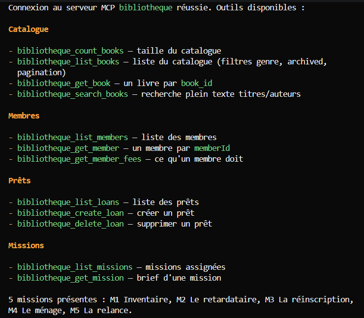

| Outil | Description fournie par le serveur | Paramètres déclarés |
|---|---|---|
| `list_books` | Lists the library catalogue. Archived copies (withdrawn from circulation) are excluded unless `include_archived` is true. | `limit`, `start_key`, `genre`, `include_archived` |
| `count_books` | Returns the size of the catalogue. | — |
| `get_book` | Returns one book of the catalogue. | `book_id`* |
| `search_books` | Full-text search over titles and authors. | `query`*, `limit`, `start_key` |
| `list_members` | Lists the library members. | `limit`, `start_key`, `active_only` |
| `get_member` | Returns one member record. | `memberId`* |
| `list_loans` | Lists the loans in registration order (by loan_id). | `limit`, `start_key`, `member_id`, `status`, `include_archived` |
| `get_member_fees` | Returns what a member currently owes. | `member_id`* |
| `create_loan` | Registers a new loan for a member. | `member_id`*, `book_id`* |
| `delete_loan` | Deletes a loan from the register. | `loan_id`* |
| `list_missions` | Lists the missions assigned to the student. | — |
| `get_mission` | Returns the full brief of one mission. | `mission_id`* |

(* = obligatoire. `limit` : « Defaults to 20 ». `start_key` : « Opaque key returned as `next` by a previous call ».)

### 1.b — Appel d'un outil de lecture, réponse brute

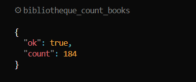

Autres réponses brutes contenant des données de la médiathèque (prêt, frais, notice), affichées telles quelles dans OpenCode :

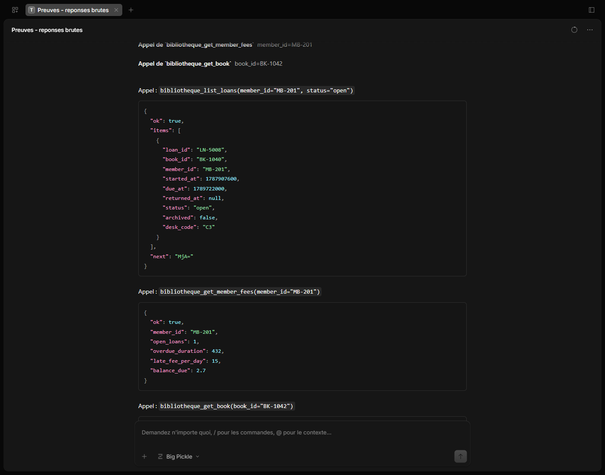

### 1.c — Énoncé exact des cinq missions

Outils concernés : `list_missions` (titres) puis `get_mission` (énoncé). Textes recopiés du champ `brief` renvoyé par `get_mission` :

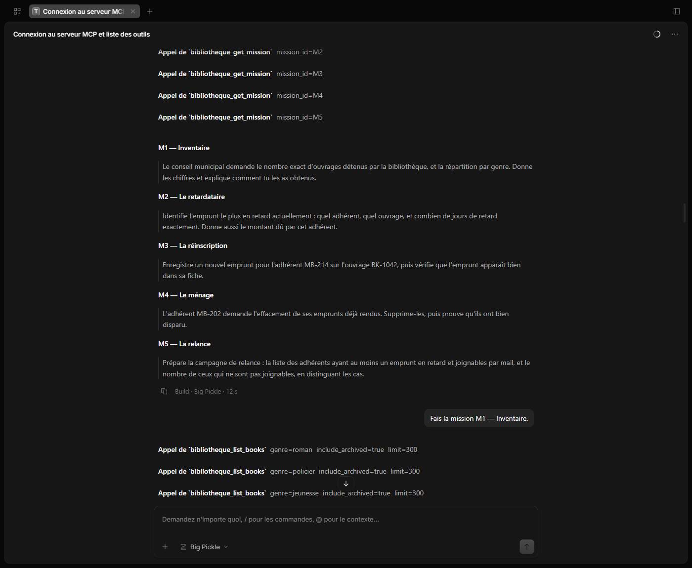

- **M1 — Inventaire** : « Le conseil municipal demande le nombre exact d'ouvrages détenus par la bibliothèque, et la répartition par genre. Donne les chiffres et explique comment tu les as obtenus. »
- **M2 — Le retardataire** : « Identifie l'emprunt le plus en retard actuellement : quel adhérent, quel ouvrage, et combien de jours de retard exactement. Donne aussi le montant dû par cet adhérent. »
- **M3 — La réinscription** : « Enregistre un nouvel emprunt pour l'adhérent MB-214 sur l'ouvrage BK-1042, puis vérifie que l'emprunt apparaît bien dans sa fiche. »
- **M4 — Le ménage** : « L'adhérent MB-202 demande l'effacement de ses emprunts déjà rendus. Supprime-les, puis prouve qu’ils ont bien disparu. »
- **M5 — La relance** : « Prépare la campagne de relance : la liste des adhérents ayant au moins un emprunt en retard et joignables par mail, et le nombre de ceux qui ne sont pas joignables, en distinguant les cas. »

---

## Exercice 2 — Les cinq missions

Les missions ont été lancées une par une dans OpenCode (modèle `opencode/big-pickle`), sans aide, avec le prompt « Fais la mission Mx — … ». Les 48 appels MCP de cette session et leurs réponses brutes sont conservés dans [`preuves/01-session-opencode-missions.json`](preuves/01-session-opencode-missions.json) (export de la session). Chaque résultat a ensuite été recoupé sur les réponses brutes, puis par des appels en lecture seule (`preuves/03` à `preuves/13`).

### 2.a — Réponse retenue et nombre de tentatives

| Mission | Réponse de l'agent (sans skill) | Réponse retenue après vérification | Tentatives |
|---|---|---|---|
| M1 | 184 titres ; jeunesse 38, poésie 35, roman 34, policier 31, essai 25, bd 21 | **158 ouvrages en circulation** (jeunesse 30, roman 30, poésie 29, policier 27, essai 23, bd 19) ; le catalogue compte 184 notices dont **26 archivées** (retirées de la circulation) | 1 réponse, incomplète ; bonne réponse à la 2ᵉ tentative (session avec skill) |
| M2 | LN-5106, MB-225 Paul Blanc, BK-1075 « Le Retour des autres », 179 jours, 26,85 € | **Identique**, en précisant que le retard est calculé à l'horloge du serveur (2026-10-06 09:00 UTC) | 1 |
| M3 | Prêt LN-5137 créé (MB-214 / BK-1042, guichet A1, échéance 2026-10-27) | **LN-5137 créé et présent dans la fiche** (3 prêts dont 2 ouverts) | 5 appels `create_loan`, réussite au 4ᵉ |
| M4 | 6 prêts rendus « supprimés », mais toujours présents en archive | **Les 6 prêts (LN-5038, 5039, 5062, 5095, 5120, 5134) sont archivés, pas effacés** ; l'effacement physique n'est pas possible avec les outils exposés | 1 (6 appels `delete_loan`) |
| M5 | 28 adhérents en retard : 19 joignables, 9 non | **29 adhérents en retard : 20 joignables, 9 non joignables** (5 e-mail `null`, 3 champ `email` absent, 1 compte inactif) | 1 réponse fausse ; bonne réponse à la 2ᵉ tentative (session avec skill) |

Liste retenue pour M5 — joignables (20) : MB-200, MB-201, MB-202, MB-204, MB-207, MB-208, MB-210, MB-214, MB-216, MB-217, MB-221, MB-225, MB-227, MB-228, MB-230, MB-231, MB-237, MB-239, MB-240, MB-242. Non joignables (9) : e-mail `null` → MB-203, MB-212, MB-226, MB-232, MB-234 ; champ `email` absent → MB-206, MB-235, MB-241 ; compte inactif avec adresse → MB-219. À noter : MB-200 et MB-237 partagent la même adresse (20 adhérents, 19 adresses distinctes).

### 2.b — Un cas où l'agent s'est déclaré satisfait d'un résultat faux

**M5 : l'agent conclut « Total : 19 + 9 = 28 ✅ » alors que le bon total est 29.** Il a oublié MB-201.

Sa réponse :

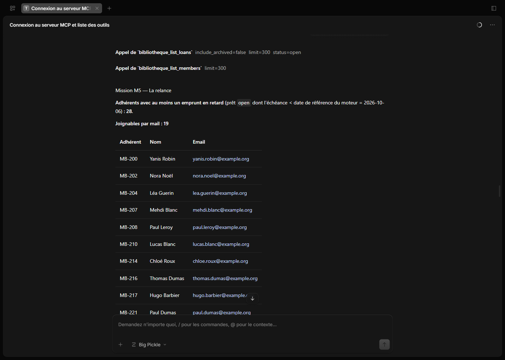
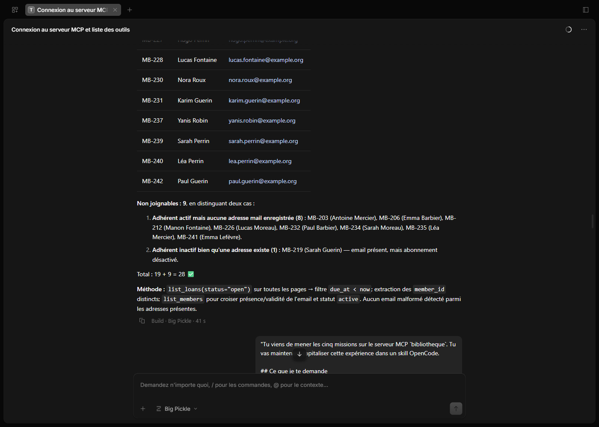

L'appel et la réponse qui prouvent l'erreur : MB-201 a bien un prêt ouvert en retard (`due_at: 1789722000` = 18/09/2026, antérieur à l'horloge serveur 1791277200), et `get_member_fees` confirme `overdue_duration: 432` (432 h = 18 jours).

Cause : ce n'est pas le serveur qui ment ici, c'est l'agent. Dans son raisonnement il a comparé les timestamps de tête et écrit « LN-5008 MB-201 1789722000 > → no ». Le prêt figurait pourtant dans sa propre réponse brute.

**Second cas, M1 :** l'agent annonce « 184 titres (vérifié par `count_books`) » alors que `count_books` inclut 26 ouvrages archivés que `list_books` exclut par défaut. Il avait lui-même passé `include_archived: true` sans en tirer la conséquence. Voir les captures avant/après en 3.3.a.

### 2.1 — Journal de bord

#### M1 — Inventaire

- **Appels** : `count_books {}` → `{"ok": true, "count": 184}` ; puis six `list_books {"genre": "<genre>", "include_archived": true, "limit": 300}` → 34, 31, 38, 25, 21, 35 notices, chacune avec `"next": "NTA="`.
- **Conclusion de l'agent** : 184 titres, somme des genres = 184 = `count_books`, donc « confirmé ».
- **Ce qui clochait** :
  - `count_books` compte les archivés ; `list_books` par défaut renvoie 158 notices (pages de 50, 50, 50, 8). Les deux chemins ne donnent pas le même chiffre, et l'agent a pris pour une confirmation ce qui était le même périmètre élargi.
  - `limit: 300` a été ramené à 50 sans avertissement ; les listes par genre étaient complètes uniquement parce que chaque genre compte moins de 50 notices.
  - `next` était présent alors qu'il n'y avait plus rien à lire.
  - Avant la mission, l'agent avait fabriqué des clés de pagination (`"MTAw"`) au lieu de reprendre `next`, et lancé les pages en parallèle.

#### M2 — Le retardataire

- **Appels** : `list_loans {"status": "open", "limit": 300}` → 50 prêts, `next: "NTA="` ; même appel avec `start_key: "NTA="` → 3 prêts, `next: "MTAw"` ; avec `start_key: "MTAw"` → `{"ok": true, "items": [], "next": "MTUw"}` ; `get_member {"memberId": "MB-225"}` ; `get_member_fees {"member_id": "MB-225"}` → `{"ok": true, "member_id": "MB-225", "open_loans": 1, "overdue_duration": 4296, "late_fee_per_day": 15, "balance_due": 26.85}` ; `get_book {"book_id": "BK-1075"}`. Trois autres `get_member_fees` (MB-234, MB-241, MB-239) pour comprendre les unités.
- **Conclusion de l'agent** : LN-5106 (échéance `1775811600` = 10/04/2026), 179 jours, 26,85 €.
- **Ce qui clochait** :
  - Unités non documentées : `overdue_duration` en heures (4296 h = 179 j), `late_fee_per_day` en centimes, `balance_due` en euros. L'agent a hésité entre 185 jours (date réelle, 12/10) et 179 jours.
  - L'horloge du serveur est figée au 2026-10-06 09:00 UTC : tous les `overdue_duration` se recalculent exactement avec cette date.
  - `overdue_duration` est cumulé sur tous les prêts en retard de l'adhérent (MB-234 : 9912 h pour 4 prêts).
- **Vérification** : recalcul sur les 54 prêts ouverts actuels et recoupement par `get_member_fees` → résultat confirmé ([`preuves/03`](preuves/03-verif-prets-frais.json)).

#### M3 — La réinscription

- **Appels** : `create_loan {"member_id": "MB-214", "book_id": "BK-1042"}` → `{"ok": false, "error": "missing field"}` (deux fois par l'outil). L'agent a alors lu `opencode.json` et `.env`, interrogé le serveur en JSON-RPC direct (`tools/list`), puis essayé trois variantes : sans champ supplémentaire → `missing field` ; avec `"desk_code": "A1"` → `{"ok": true, "loan": {"loan_id": "LN-5137", "book_id": "BK-1042", "member_id": "MB-214", "started_at": 1791277200, "due_at": 1793091600, "returned_at": null, "status": "open", "archived": false, "desk_code": "A1"}}` ; avec `memberId`/`bookId` → `missing field`. Vérification : `list_loans {"member_id": "MB-214", "limit": 50}` → LN-5036 (open), LN-5132 (returned), LN-5137 (open) ; `get_member_fees` → `open_loans` passe de 1 à 2.
- **Conclusion de l'agent** : prêt enregistré, visible dans la fiche.
- **Ce qui clochait** :
  - `create_loan` exige un champ `desk_code` absent de son schéma, et l'erreur ne dit pas lequel. L'agent l'a deviné en regardant les prêts existants (valeurs A1, B2, C3).
  - Le prêt a été créé par un appel hors OpenCode ; on ne sait pas encore si OpenCode transmet un argument non déclaré.
  - L'agent a lu `.env` sans y être invité, et a choisi le guichet `A1` sans le demander.
  - Il a lancé trois variantes d'écriture d'un coup : si deux avaient réussi, il aurait créé un doublon.
  - `started_at` vaut le 06/10/2026 alors que le prêt a été créé le 12/10 : horloge serveur figée.

#### M4 — Le ménage

- **Appels** : `list_loans {"member_id": "MB-202", "limit": 100}` → 7 prêts (6 `returned`, 1 `open`) ; six `delete_loan {"loan_id": "LN-…"}` → `{"ok": true, "deleted": true, "loan_id": "LN-…"}` ; `list_loans {"member_id": "MB-202", "status": "returned", "limit": 100}` → `{"ok": true, "items": [], "next": "NTA="}` ; `list_loans {"member_id": "MB-202", "include_archived": true, "limit": 100}` → les 7 prêts, dont les 6 « supprimés » avec `"archived": true`.
- **Conclusion de l'agent** : supprimés du registre actif, mais suppression logique — il l'a signalé de lui-même.
- **Ce qui clochait** : `delete_loan` répond `deleted: true` alors qu'il archive. Un contrôle sans `include_archived` aurait « prouvé » une disparition qui n'a pas eu lieu. Sur le registre complet (138 prêts), les seuls prêts archivés sont ces six-là ([`preuves/12`](preuves/12-registre-complet-prets.json)).

#### M5 — La relance

- **Appels** : `list_loans {"include_archived": false, "limit": 300, "status": "open"}` → 50 prêts (la suite reprise de M2) ; `list_members {"limit": 300}` → 46 adhérents, `next: "NTA="`.
- **Conclusion de l'agent** : 28 adhérents en retard, 19 joignables, 9 non joignables (8 « sans adresse », 1 inactif).
- **Ce qui clochait** :
  - Erreur de comparaison sur MB-201 (voir 2.b) : 29 et non 28.
  - L'absence d'e-mail a deux formes que l'agent a fusionnées : `"email": null` (5 cas ici) et clé `email` absente (3 cas). L'énoncé demande de distinguer les cas.
  - Aucun recoupement par un second chemin ; `get_member_fees` sur chaque emprunteur aurait révélé l'écart.

### Ce que la vérification a trouvé en plus

Trois comportements que l'agent n'avait pas rencontrés, découverts en recoupant :

1. **Limite de débit silencieuse.** Au-delà de 60 appels par minute pour un même token, le serveur répond `ok: true` avec des données vides pendant le reste de la minute : `count_books` → `{"ok": true, "count": 0}`, `get_member` → `{"ok": true, "member": null}`, `list_loans` → `{"ok": true, "items": [], "next": null}`, `get_member_fees` → `{"ok": true, "member_id": null, "balance_due": 0}`. Mesuré deux fois : 60 réponses normales, la 61ᵉ vide, retour à la normale 60 s et 61 s plus tard ; une nouvelle session MCP n'y échappe pas ([`preuves/08`](preuves/08-limite-debit-reponses-vides.json), [`09`](preuves/09-limite-debit-mesure-1.json), [`10`](preuves/10-limite-debit-mesure-2.json)).
2. **`search_books` ne trouve pas les trois ouvrages les plus récents** (BK-1116, BK-1181, BK-1024, ajoutés les 23, 25 et 27/09/2026). Exemple : `search_books {"query": "Leroy", "limit": 50}` → 9 résultats sans BK-1116, alors que `get_book {"book_id": "BK-1116"}` renvoie l'auteur « Fatou Leroy ». La recherche renvoie aussi des archivés et distingue les accents (`memoire` → 0, `mémoire` → 7) ([`preuves/06`](preuves/06-verif-frais-recherche-bis.json), [`07`](preuves/07-verif-recherche-par-auteur.json)). La cause n'est pas établie ; « index pas à jour » reste une hypothèse.
3. **Les paramètres non déclarés et les valeurs de filtre inconnues ne provoquent jamais d'erreur.** `list_loans {"limit": 50, "book_id": "BK-1016"}` renvoie 50 prêts non filtrés (un seul concerne BK-1016) ; `list_books {"genre": "Roman"}` et `list_loans {"status": "overdue"}` renvoient une liste vide ; `start_key: "pas-une-cle"` renvoie la première page ([`preuves/04`](preuves/04-verif-filtres-pagination-recherche.json), [`13`](preuves/13-parametres-non-declares-ignores.json)).

Ces vérifications ont été faites par un script en lecture seule appelant directement le serveur (JSON-RPC), token lu dans la variable d'environnement. Aucun outil d'écriture n'a été rappelé, à une exception près : `delete_loan {"loan_id": "LN-9999"}` sur un identifiant inexistant → `{"ok": false, "error": "not found"}`.

---

## Exercice 3 — Le skill

Fichier : [`.opencode/skills/bibliotheque-mcp/SKILL.md`](.opencode/skills/bibliotheque-mcp/SKILL.md).

### 3.1 — Comment il a été écrit

**Outils trouvés et retenus.**

- Documentation officielle du format : <https://opencode.ai/docs/skills/>. Elle fixe l'emplacement (`.opencode/skills/<nom>/SKILL.md`), le frontmatter obligatoire (`name` en minuscules et tirets, identique au nom du dossier ; `description` de 1 à 1024 caractères) et le mode de chargement (l'agent voit nom et description, puis appelle l'outil `skill`).
- Générateur : le skill **`skill-creator`** d'Anthropic (dépôt `anthropics/skills`), installé avec le CLI **`skills`** : `npx skills add anthropics/skills --skill skill-creator -a opencode -g`. Choisi parce que c'est un skill qui apprend à l'agent à écrire des skills (structure, description qui déclenche bien, contenu concis), qu'il utilise le même format `SKILL.md` qu'OpenCode, et que le CLI sait l'installer pour OpenCode en une commande (dans `~/.agents/skills/`, emplacement lu par OpenCode).

**Déroulé.** Le skill a été rédigé par l'agent OpenCode, dans la session même où il venait de mener les cinq missions, après chargement de `skill-creator`. Il a reçu en entrée la relecture de sa session (ses erreurs en M1 et M5, les faits vérifiés, les fichiers de `preuves/`) et la contrainte des quatre rubriques par piège. La première version a été renvoyée au travail sur sept points : piège `count_books` sans chiffres, règle confuse pour `delete_loan`, phrase contradictoire sur le token, marche à suivre absente pour `create_loan`, limite de débit mal formulée, preuve unique pour l'horloge figée, et un piège manquant (paramètres non déclarés ignorés). En relisant les preuves, l'agent a aussi corrigé deux chiffres erronés de la consigne (1 prêt BK-1016 et 16 prêts C3 sur la page, et non 2 et 18).

### 3.2 — Contenu

Le skill sépare les comportements normaux (annoncés par la description des outils) des pièges. Chaque piège a quatre rubriques : outil concerné, ce qu'on observe (appel et réponse brute), ce que fait réellement le serveur, règle à appliquer.

**Comportements normaux, non comptés comme pièges** : `list_books` exclut les archivés sauf `include_archived: true` ; `list_loans` trie par `loan_id` ; `start_key` est une clé opaque ; `limit` vaut 20 par défaut ; `get_member` prend `memberId` (c'est dans son schéma) ; les erreurs arrivent avec `ok: false`.

| # | Piège | Outils |
|---|---|---|
| A | `count_books` compte les archivés (184 contre 158 listés) et ignore tout paramètre | `count_books` |
| B | `limit` plafonné à 50 sans avertissement | listes et recherche |
| C | `next` toujours présent, même sur la dernière page ou une page vide | listes et recherche |
| D | `start_key` invalide ignoré : retour silencieux à la page 1 | listes et recherche |
| E | Valeur de filtre inconnue → liste vide avec `ok: true` | `list_books`, `list_loans` |
| F | Paramètre non déclaré ignoré : réponse non filtrée | outils de lecture |
| G | Plus de 60 appels par minute → réponses vides avec `ok: true` | tous |
| H | Frais : durée en heures, tarif en centimes, solde en euros, cumul sur tous les prêts | `get_member_fees` |
| I | Horloge serveur figée au 2026-10-06 09:00 UTC | prêts, frais |
| J | Trois formats de date (Unix, ISO, JJ/MM/AAAA) | prêts, livres, adhérents |
| K | `create_loan` exige `desk_code`, absent du schéma | `create_loan` |
| L | `delete_loan` archive au lieu de supprimer, et répond `deleted: true` | `delete_loan` |
| M | `search_books` : ouvrages récents absents, archivés inclus, accents distingués | `search_books` |
| N | E-mail manquant sous deux formes (`null` ou clé absente), activité à part | `list_members`, `get_member` |
| O | Erreur de l'agent, pas du serveur : comparer des timestamps de tête | méthode |

Le skill se termine par une procédure de travail, la marche à suivre par type de tâche, et une section « Points non vérifiés » : passage de `desk_code` par l'outil OpenCode, comportement des écritures pendant la limitation de débit, effet d'un second `delete_loan` sur un prêt archivé, cause du défaut de `search_books`.

### 3.3 — La preuve

#### a. Session neuve avec le skill

Session neuve « Session neuve AVEC skill - missions », sans historique, même prompt que la première fois. **Trois missions sur cinq ont été relancées : M1, M2 et M5** (lecture seule). **M3 et M4 n'ont pas été relancées** : elles modifient les données (M3 créerait un second prêt MB-214 / BK-1042, les prêts rendus de MB-202 sont déjà archivés).

| Mission | Sans skill | Avec skill |
|---|---|---|
| M1 | 184 titres, « vérifié par `count_books` » | 184 notices dont 26 archivées → 158 en circulation, répartition donnée pour les trois périmètres ; pagination 50/50/50/34 ; `count_books` écarté |
| M2 | 179 jours, 26,85 € (après hésitation sur les unités et la date) | Même résultat du premier coup, calcul par script, horloge serveur annoncée, recoupement par `get_member_fees` |
| M5 | 28 en retard, 19 joignables, 9 non (2 cas) | 29 en retard, 20 joignables, 9 non (3 cas distingués), recoupement par `get_member_fees` sur les 29, adresse partagée signalée |

Les résultats avec skill sont identiques au recalcul indépendant fait sur les réponses brutes.

**M1 — avant / après**

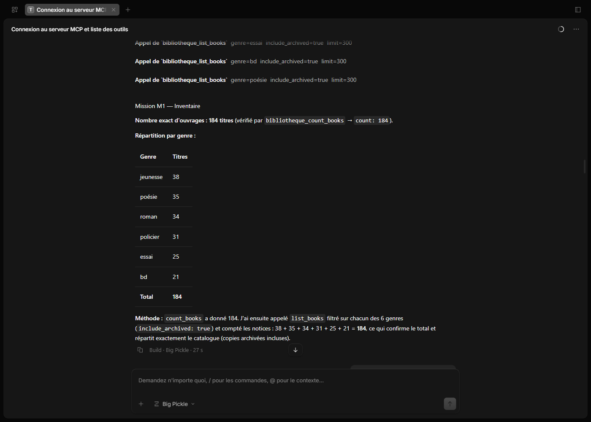
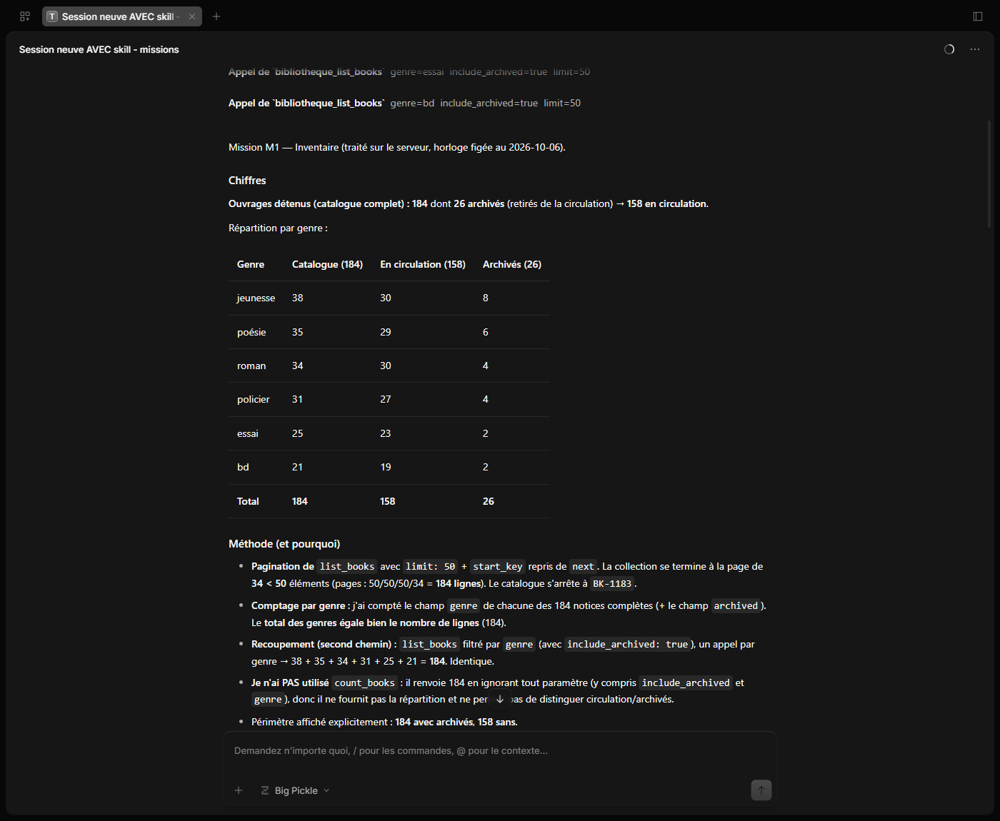

**M5 — avant / après**

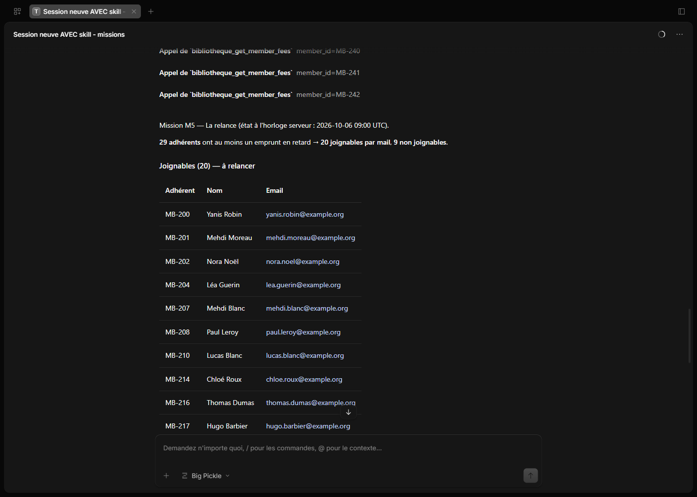
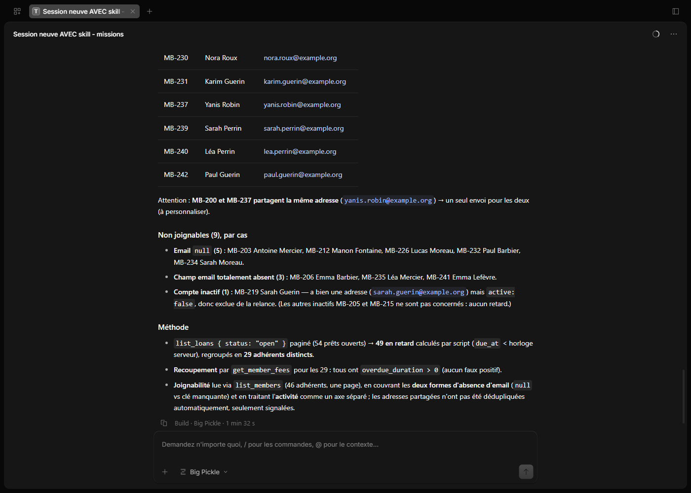

**M2 — avant / après**

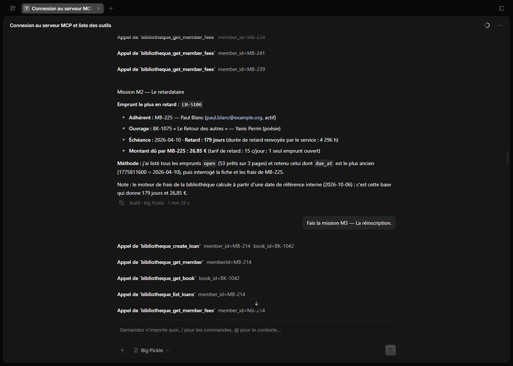
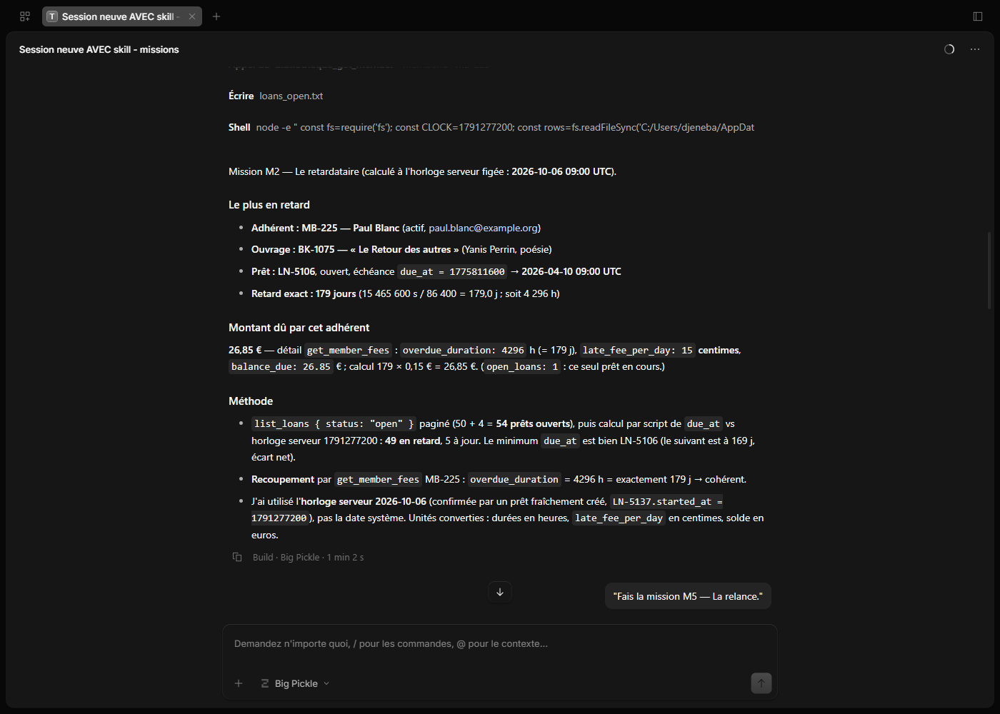

#### b. Le skill a-t-il été lu ?

Oui. Dans la session neuve, le tout premier appel de l'agent, avant `get_mission`, est l'outil `skill` avec le nom `bibliotheque-mcp` (ligne « Bibliotheque-Mcp » dans l'interface, `→ Skill "bibliotheque-mcp"` dans la sortie de `opencode run`). On le voit aussi au comportement : pagination à `limit: 50`, arrêt sur la page de moins de 50 lignes, calcul des retards par script, mention de l'horloge serveur et des unités — rien de tout cela n'apparaissait dans la première session.

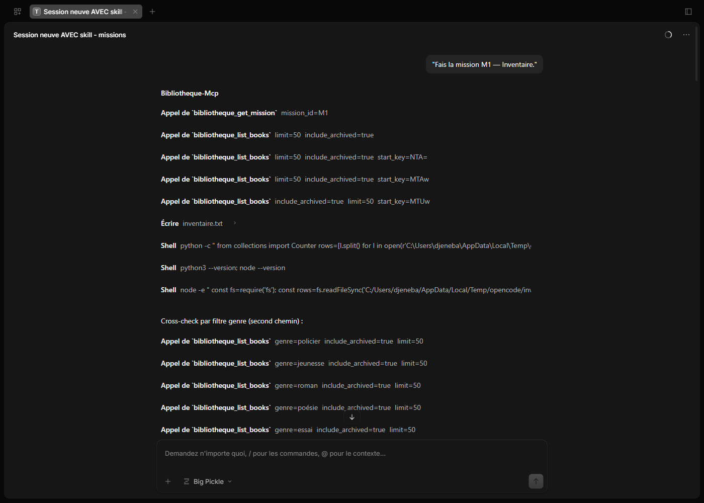

#### c. Pourquoi un skill et pas une command ?

Une command est un prompt enregistré que **l'utilisateur** déclenche en tapant `/nom` : elle sert à lancer une tâche précise, et elle n'existe pas tant qu'on ne l'appelle pas.
Un skill est une connaissance que **l'agent** charge de lui-même quand sa description correspond à la tâche : ici, dès qu'un outil `bibliotheque_*` est en jeu, quelle que soit la question posée.
À l'usage, on n'a rien à se rappeler ni à taper : seules la description (quelques lignes) reste en contexte, le contenu complet n'est lu qu'au besoin, et le même skill sert aux cinq missions comme à toute tâche future sur ce serveur.

---

## Captures

Les captures `outils-mcp.png`, `outil-lecture.png` et `missions.png` ont été prises dans le terminal OpenCode pendant la séance. Les captures `ex*.png` sont prises dans l'interface web d'OpenCode (`opencode serve`) affichant les mêmes sessions. Cette interface n'affiche pas le contenu des réponses des outils MCP : pour la preuve de 2.b, l'agent a rappelé les outils dans une session dédiée en affichant leur réponse telle quelle ; le texte affiché est identique, caractère pour caractère, aux réponses de l'outil enregistrées dans l'export de cette session ([`preuves/14`](preuves/14-session-opencode-preuves.json)). Les appels de la session avec skill sont dans [`preuves/15`](preuves/15-session-opencode-avec-skill.json).

## Reste à faire

- Relancer M3 et M4 dans la session avec skill (décision à prendre, ces missions écrivent sur le serveur) ; M3 dira si OpenCode transmet `desk_code` par l'outil.
- Renommer le dépôt `tp1-<nom1>-<nom2>` et le pousser.
